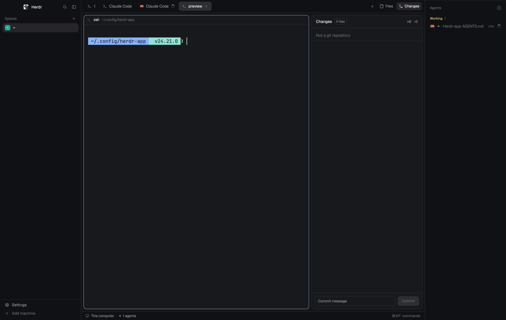

# dehottdog

Herdr's default window with the agents list moved to its own column on the right. Spaces get the whole left sidebar, the tabs and panes sit in the middle, and the agents you're running stay visible on the right, as tall as the window. `cmd-shift-b` hides and shows the agents column.

## What you see

Left to right:

1. **Left sidebar**, 268px wide (44 to 480px), `chrome` background.
   - Brand bar, 46px: the `workspace-chrome` mod (Herdr logo, search, sidebar button). Dragging it moves the window. On macOS the window buttons sit over it at `[12, 16]`.
   - Spaces list, fills the rest of the column (at least 90px): the `spaces` mod.
   - Footer, 69px: `workspace-chrome` with `props: { footer: true }` (Settings, Add machine).
2. **Work column**, takes the remaining width.
   - Tab bar, 42px: the `tabs` mod (tabs as pills, the + menu, Files and Changes buttons). Dragging it moves the window.
   - Work body, 8px padding, 8px gap:
     - The active tab's panes as cards: 10px corners, `background` fill, 1px `border` edge, 1px `accent` edge on the focused pane, 8px between panes. Each pane has a 30px header on top drawn by the `pane` mod, shown all the time. A tab's only pane gets a card too.
     - Files/Changes panel, 368px (280 to 900px), hidden until opened from the tab bar. A stack of the `files` and `changes` mods.
   - Status bar, 28px: the `workspace-status` mod.
3. **Right sidebar**, 268px wide (44 to 480px), `chrome` background: the `dehottdog-agents` mod (a clone of Herdr's `agents`) filling the whole column. Below 160px wide it draws a narrow rail: a count and one status icon per agent, with a `»` button at the bottom.

The root is a row on `canvas` with a 1px `border` divider between columns, no system title bar, and `[14, 12]` terminal padding. The layout sets no theme, fonts or text size, so the person's `settings.json` decides them.

## How it behaves

- **Agent statuses** (`dehottdog-agents`, same as Herdr's `agents` mod, sorted by priority by default, or grouped by space from the clock button):
  - blocked: listed under "Needs you" with a "Needs you" pill in the theme's `blocked` color.
  - done: listed under "Done" with a filled dot in `done`. It stays under Done while you look at it, then becomes idle.
  - working: listed under "Working" with a ring spinner in `working`.
  - idle: listed under "Idle" with a hollow ring in `idle`.
  - Pinned agents get their own "Pinned" section at the top.
- Clicking an agent focuses its pane.
- `cmd-b` (Herdr's default key) toggles the left sidebar. `cmd-shift-b` toggles the right sidebar (`layout.toggle:right-sidebar`), only in this layout.
- Files and Changes in the tab bar open the right-hand panel inside the work column.
- The agents column goes to its rail when it is narrower than 160px, whatever the left sidebar's width. In the rail, `»` widens it back to the width it had before (268px if none was saved). Expanded, the same button folds it to a 44px rail.

## Built from

- One layout file, `layouts/dehottdog.json`, cloned from Herdr's `main` (version 0.1.14) with `layout.clone {"name":"main","as":"dehottdog"}`. Changes from `main`:
  - The `agents` block moved out of the left sidebar's `sidebar-lists` column into a new root child, `right-sidebar`, placed after `work`, and now shows `{"mod": "dehottdog-agents"}`.
  - `right-sidebar` is a column: `size {px: 268}`, `min 44`, `max 480`, `background: "chrome"`. The `agents` block in it has `size {weight: 1}` and no `min`.
  - `"preview": "layouts/dehottdog.svg"` on the root.
- Node tree: `root` (row) > `sidebar` (column: `brand`, `sidebar-lists` > `spaces`, `sidebar-footer`), `work` (column: `tabs`, `work-body` row > `main` + `panel` stack of `files`/`changes`, `status`), `right-sidebar` (column: `agents`).
- Shipped mods: `workspace-chrome`, `spaces`, `tabs`, `pane`, `files`, `changes`, `workspace-status`.
- Its own mod, `mods/dehottdog-agents/`, cloned from Herdr's `agents` (0.1.14) with `mod.clone {"name":"agents","as":"dehottdog-agents"}`. Two changes in `main.js`:
  - `narrow()` reads the width of the `right-sidebar` node instead of `sidebar`.
  - `toggleSidebar()` (the `»` button) resizes `right-sidebar`, keeps its width in shared `right-sidebar.width`, folds to 44px on every platform, and no longer sets shared `sidebar.collapsed`.
  - It still draws its icons from `mods/workspace-chrome/` and opens its sort menu as a `dehottdog-agents` popup.
- `keys.json`: a `layout:dehottdog` section with `"cmd-shift-b": "layout.toggle:right-sidebar"`.
- Art: `layouts/dehottdog.svg`, a 320×200 sketch of the window for the settings screen, in fixed dark colors.

## Watch out

- Herdr's shipped `agents` mod decides whether to draw its rail from the width of the node with id `sidebar`, the left one. Used on the right, it follows the left sidebar's width and its `»` button resizes the left sidebar. That is why this layout ships `dehottdog-agents`. Don't point the block back at `agents`.
- `dehottdog-agents` is a clone: Herdr never updates it, so it won't get fixes made to `agents` in later versions.
- The `»` arrow points right in both states. It was drawn for a left sidebar.
- `cmd-b` and the sidebar button in the brand bar affect only the left sidebar. The agents column has its own key.
- Merging `keys.json` makes the person's keys file their own. Herdr stops adding new default shortcuts to it on upgrade.
- The preview SVG doesn't follow the theme or light mode.
- The `traffic_lights` position applies on macOS. On Linux and Windows, `workspace-chrome` draws the window buttons, as in `main`.
- Built against Herdr 0.1.14's shipped mods. Ids such as `sidebar` and `right-sidebar` must keep these names, because the mods look them up by id.

## Done when

- `herdr-app do layout.switch '{"name":"dehottdog"}'` shows the agents list in a full-height column on the right, and Spaces fills the left sidebar.
- `herdr-app status` reports `"errors": []`, and there is no `layouts/dehottdog.error` or `keys.error`.
- `cmd-shift-b` hides the right sidebar and shows it again. `cmd-b` still toggles the left one.
- Settings → Look shows the dehottdog picture on its layout card.
- `herdr-app check mods/dehottdog-agents` passes.
- `layout.resize {"id":"right-sidebar","px":120}` turns the agents column into its rail. `layout.resize {"id":"sidebar","px":76}` leaves it a full list.
- Clicking `»` in the rail widens the agents column again, and the left sidebar doesn't move.
- An agent going working, blocked and done shows the spinner, "Needs you" pill and dot in the right column.
